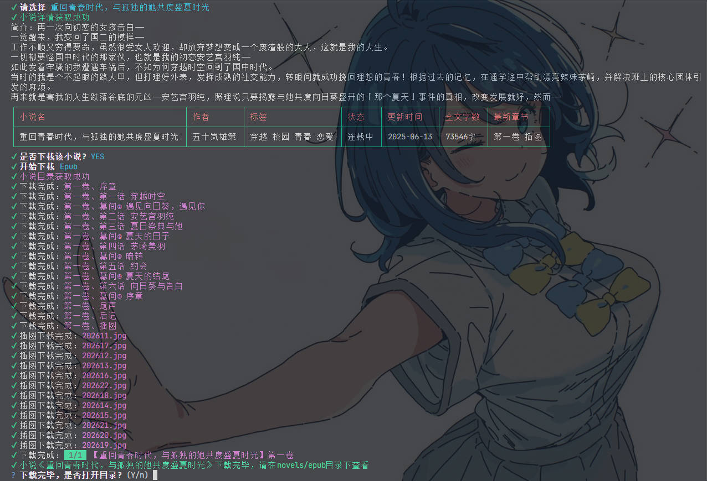

<div align="center">
<h1 align="center" style="margin-top: 0">wenku8轻小说下载器</h1>
<p align="center">
<strong>基于 Bun + TypeScript 的轻小说下载工具</strong>
</p>

[](https://github.com/fateking27/wenku8-downloader)


[](https://github.com/fateking27/wenku8-downloader/releases/latest)

</div>



## 功能特性

本工具用于下载 [轻小说文库](https://www.wenku8.net/index.php) 的小说内容：

- ✅ 支持下载 **EPUB** 电子书（封面、插图、目录，支持逐卷自定义封面）
- ✅ 支持下载 **TXT** 电子书
- ✅ 支持仅下载小说插图
- ✅ 支持下载 **已下架小说**
- ✅ 多代理支持（HTTP 代理）

## 🚀 快速开始

### 方式一：直接使用（推荐）

[下载](https://github.com/fateking27/wenku8-downloader/releases/latest) 最新版本，解压后双击运行
`wenku8-downloader.exe`。

### 方式二：源码运行

需要先安装 [Bun](https://bun.sh/) 运行环境。

```bash
git clone https://github.com/fateking27/wenku8-downloader.git
cd wenku8-downloader

bun install
bun start
```

## 使用指南

### 主菜单

| 选项 | 功能说明 |
|------|----------|
| 查询小说 | 通过 ID、小说名或作者名搜索小说 |
| 今日热榜 | 查看当日热门小说排行 |
| 新书风云榜 | 查看最新上架的小说 |
| 查看最近更新轻小说 | 查看近期有更新的小说列表 |
| 账户设置 | 查看 / 修改账号密码，立即登录验证，清除账号 |
| 退出 | 结束程序 |

### 下载选项

| 格式 | 说明 |
|------|------|
| Epub | 按分卷生成带封面、插图和目录的电子书 |
| TXT | 按分卷生成纯文本 |
| 插图 | 仅下载插图 |

输出目录：

```
novels/
├── epub/<小说名>/<分卷ID>-<分卷名>.epub
└── txt/<小说名>/<分卷ID>-<分卷名>.txt
插图/<小说名>/
├── cover.jpg
└── <分卷名>/<插图文件>
```

## 👤 账户设置

主菜单选择「账户设置」可以：

- 输入 / 修改账号和密码；
- 立即登录验证；
- 登录成功后会更新 `wenku8.json` 中的 Cookie；
- 清除账号密码（可选择是否同时清除 Cookie）。

> ⚠️ 账号密码会以**明文**保存在 `wenku8.json` 中。

## ⚙️ 配置文件

### `wenku8.json`

```json
{
  "cookie": "",
  "username": "",
  "password": "",
  "app": {
    "ver": "",
    "flavor": "",
    "language": 0
  }
}
```

### `proxy.config.json`

```json
{
  "proxy": true,
  "noProxyUrls": [
    "img.wenku8.com",
    "pic.777743.xyz",
    "wenku8-relay.mewx.org"
  ],
  "proxyList": [
    "127.0.0.1:7890"
  ]
}
```

- `proxy`：是否启用代理。
- `proxyList`：HTTP 代理列表，格式 `IP:端口`，每次请求随机选择一个。
- `noProxyUrls`：命中这些片段的地址**直连**（通常是不希望走代理的图片站）。

## 🧑‍💻 开发

```bash
bun start          # 运行
bun run dev        # 开发运行
bun run typecheck  # tsc --noEmit
bun test           # 单元测试（含版权受限回归）
bun run build      # 打包为可执行文件
bun scripts/smoke.ts  # 联网自检
```

```
src/
├── app/       签名验证、XML、客户端
├── http/      统一请求、代理、网页抓取
├── web/       网页解析
├── domain/    详情 / 目录 / 正文 / 搜索榜单 / 图片
├── export/    EPUB / TXT / 插图
├── ui/        交互
└── util/      工具
```

## ⚠️ 注意事项

1. **网络问题**：wenku8 站点启用 Cloudflare，网页请求可能返回 403 或被限流。
   也可以在 `proxy.config.json` 中配置代理。
2. **请求频率**：为避免触发限流，程序在章节之间保留了间隔（网页约 0.9s），
   下载整本小说需要一些时间。
3. **模板依赖**：EPUB 生成依赖项目根目录（或程序目录）下的 `@lesjoursfr/`，请勿删除。
4. **仅供个人学习使用**：请尊重版权，不要传播下载内容。

## 开源协议

本项目基于 [MIT](LICENSE) 协议开源。

## 数据来源

- 数据来源：[轻小说文库](https://www.wenku8.net/)
